# Self-Hosted Production Infrastructure & Operations Runbook (v7)

**Architecture:** Debian stable + Pure Docker Compose + Hybrid CrowdSec IPS  
**Author:** Massimo Ciani  
**Last Revision:** November 2026

> **Security & Sanitization Note:** This repository contains the reference configuration and operational runbook for my self-hosted production server. All production domain names, local and internal IP ranges, custom host ports, and filesystem paths have been replaced with the matching environment variables defined in `.env.template` (e.g., `${DOMAIN_1}`, `${NET_WEB_NET}x`, `${HOMELAB_DIR}`, `${BACKUP_01}`).

---

## ARCHITECTURAL PHILOSOPHY & DESIGN TRADE-OFFS

The primary objective of this infrastructure is **digital sovereignty and privacy**: taking complete ownership of personal, business, and client workloads while entirely breaking free from recurring cloud SaaS subscription costs.

### Cost-Efficiency vs. Enterprise High Availability (TCO)

* **Deliberate Simplicity over Multi-Node Redundancy:** In an enterprise environment with substantial budgets, one would typically deploy a multi-node High Availability (HA) cluster with distributed block storage (Ceph, Longhorn), redundant hardware nodes, and dual power supplies. Doing so in this context, however, would dramatically inflate upfront capital expenditure, idle electrical consumption, and operational overhead—entirely defeating the foundational goal of frugality.
* **The 2–3 Hour RTO Trade-Off:** Instead of investing in active-active local hardware redundancy, the architecture relies on an efficient, cold/warm disaster recovery strategy. Backups are pushed offsite daily via encrypted **Restic** snapshots to geographically remote S3 storage. In the event of catastrophic local hardware failure, the Recovery Time Objective (RTO) is targeted at **2–3 hours** to spin up the documented stack on alternate hardware or a cloud VPS, achieving the optimal balance between operational resilience and total cost of ownership (TCO).

---

## 0. CHANGELOG (ARCHITECTURAL EVOLUTION v1 → v7)

### v7 — October / November 2026

* **Static Web Front:** Added dedicated lightweight Nginx container `domain3_it_web` (`${NET_WEB_NET}36`) serving static production assets for `${DOMAIN_3}` behind Traefik.
* **AI Stack Refactor (Breaking Change):** Retired the local CPU-bound `ollama` container. Deployed `open_webui` (`${NET_WEB_NET}51`) as an interface connected to the **OpenRouter** cloud LLM API, exposed on `chat.${DOMAIN_2}` behind Traefik (CrowdSec + Authelia 2FA). Nextcloud Assistant re-pointed accordingly.
* **sdr_dashboard:** Integrated the B2B SaaS Next.js 14 dashboard container (`${NET_WEB_NET}60`, LAN port `3000`) with Drizzle ORM and HMR support.
* **Accuracy & Hardening Fixes:**
  * Added `aliasHeadersStrategy=reject` across Traefik entrypoints to prevent header spoofing against Authelia ForwardAuth middlewares.
  * Standardized container naming and network definitions across all WordPress instances (`${MW_NAME_1a}_php`/`nginx`, `${MW_NAME_NK1a}_main_php`/`nginx`, `${MW_SUBNAME_NK1a}_php`/`nginx`).
  * Upgraded shared database to **MariaDB 12.3 LTS** (`--innodb-buffer-pool-size=2G`, `--innodb-log-file-size=256M`, slow-query log enabled) and updated all maintenance scripts to `mariadb` / `mariadb-dump`.
  * Added `authelia`, `dolibarr`, and `sdr_saas_db` schemas to automated pre-update database dump routines.

### v5 / v6 — May – July 2026

* Added local AI inference experimentation and integrated Collabora Online (`collabora/code`) and Nextcloud `whiteboard` services.

### v3 / v4 — January – February 2026

* Upgraded Traefik v2.10 to **Traefik v3** with **HTTP/3 (QUIC)** and `crowdsec-bouncer-traefik-plugin`.
* Enforced **Authelia** (SSO & 2FA) in front of administrative endpoints (Portainer, Grafana, Dolibarr, and WordPress `/wp-login.php` / `/wp-admin`).
* Deployed observability stack: **VictoriaMetrics** (1-year TSDB retention), `node-exporter`, tuned `cadvisor`, and **Grafana**.
* Added isolated `dmz_rsync` SSH container on a segregated DMZ bridge network (`${NET_DMZ_NET}0/16`) and `diun` for automated container image update notifications.

### v1 / v2 — December 2025

* Initial migration from a 5-year bare-metal ARM64 setup to an x86_64 Docker Compose architecture: Traefik, MariaDB, Redis, Nextcloud (FPM + Read-Only Nginx), 3 WordPress sites, Hybrid CrowdSec, and **Backrest (Restic)** 3-2-1 backup pipeline.

---

## 1. HARDWARE, STORAGE & NETWORK TOPOLOGY

### A. Host Specifications

* **Chassis:** Compact Small Form Factor (SFF) PC
* **Processor:** Quad-Core 64-bit x86 CPU (4 cores / 4 threads)
* **Memory:** 8 GB DDR4 RAM (planned upgrade to 32 GB)
* **System Disk (NVMe):** 256 GB M.2 NVMe SSD
* **Internal Storage:** 500 GB SATA HDD (CMR drive, planned upgrade to 6 TB)
* **External USB Storage 1:** 4 TB USB 3.0 HDD (SMR drive)
* **External USB Storage 2:** 2 TB USB 3.0 HDD (SMR drive)
* **LAN Interface:** Gigabit Ethernet — Static lease `${NET_LOCAL}10` managed by edge gateway.

---

### B. Storage Mount Configuration (`/etc/fstab`)

| Physical Drive               | Mount Point    | Filesystem | Mount Options & Role                                                                                                                     |
|:---------------------------- |:-------------- |:---------- |:---------------------------------------------------------------------------------------------------------------------------------------- |
| **M.2 NVMe SSD**             | `/`            | EXT4       | Base OS, Docker engine, MariaDB tables, application configurations (`${HOMELAB_DIR}`).                                                   |
| **Internal SATA HDD (CMR)**  | `${BACKUP_02}` | BTRFS      | **Hot Data:** Nextcloud user files (`nc_data`), Dolibarr ERP documents. (`noatime,compress=zstd:3,space_cache=v2,autodefrag,commit=120`) |
| **External USB HDD 1 (SMR)** | `${BACKUP_01}` | BTRFS      | **Cold Repository:** Local Restic repository, photo archives, isolated `dmz_rsync` target. (`nofail,noatime,nodiscard,compress=zstd:3`)  |
| **External USB HDD 2 (SMR)** | `${DISK_01}`   | BTRFS      | Media archive mounted read-only into Nextcloud. (`nofail,noatime,nodiscard,compress=zstd:3`)                                             |

---

### C. Edge Gateway & Routing

* **Gateway Appliance:** Multi-port Gigabit hardware router
* **DHCP Server:** Subnet `${NET_LOCAL}0/24` with static IP bindings for servers and dynamic pool for local devices.
* **DNS Infrastructure:** Split-DNS static mappings resolve local hosted domains directly to `${NET_LOCAL}10` for LAN clients. All outbound LAN lookups are forced over **DNS-over-HTTPS (DoH)** via Cloudflare Security (`1.1.1.2`).
* **Dynamic DNS Automation:** Custom gateway script monitors public WAN IP changes, queries Cloudflare REST API v4 using native JSON deserialization, and dynamically updates proxied `A` records without causing redundant API calls.

---

## 2. INFRASTRUCTURE & FLOW DIAGRAM

```mermaid
graph TD
    UserWan("🌍 Internet User")
    UserLan("🏠 LAN User")
    Cloudflare("☁️ Cloudflare<br/>(CDN / DNS / WAF)")
    Router("🔥 Edge Gateway<br/>(FW + NAT + Split DNS)")
    idrivee2("☁️ Offsite S3 Storage<br/>(Encrypted 3-2-1 Backup)")
    OpenRouter("🤖 OpenRouter.ai<br/>(Cloud LLM API)")

    subgraph Host ["🖥️ PRODUCTION HOST - Debian 13 (Trixie)"]
        Firewall["🛡️ Host Firewall (UFW / NFTables)<br/>+ CrowdSec Host Bouncer"]
        SSHD["🔑 Host SSHD (Port ${HOST_SSH_PORT})"]

        subgraph Docker_Engine ["🐳 DOCKER INFRASTRUCTURE"]
            Coturn["📞 Coturn TURN<br/>(Host Network Mode)"]
            dmz_rsync["🔑 dmz_rsync SSHD (Port ${DMZ_PPORT})<br/>Isolated DMZ Bridge"]

            subgraph Web_Stack ["🌐 web_net (${NET_WEB_NET}0/16)"]
                Traefik["🚦 Traefik v3 Reverse Proxy<br/>+ CrowdSec Bouncer Plugin"]
                CS_Agent("🧠 CrowdSec Engine (LAPI)")
                Authelia["🔐 Authelia (SSO & 2FA)"]
                DB[("🗄️ MariaDB 12.3 Shared")]
                Redis[("⚡ Redis 512MB Cache")]

                subgraph Nextcloud_Stack ["Nextcloud Stack"]
                    NC_Nginx("Nginx (RO)")
                    NC_PHP("PHP-FPM Custom")
                    Collabora("Collabora Online")
                    Whiteboard("Whiteboard WS")
                end

                subgraph WP_Stack ["WordPress Instances"]
                    WP1_Nginx("${MW_NAME_1a}_nginx (RO)")
                    WP1_PHP("${MW_NAME_1a}_php")
                    WPNK_Nginx("${MW_NAME_NK1a}_main_nginx")
                    WPNK_PHP("${MW_NAME_NK1a}_main_php")
                    WPSUB_Nginx("${MW_SUBNAME_NK1a}_nginx")
                    WPSUB_PHP("${MW_SUBNAME_NK1a}_php")
                end

                StaticWeb("domain3_it_web (RO Nginx)")
                OpenWebUI("Open WebUI")
                Dolibarr["Dolibarr ERP"]
                Portainer["📦 Portainer CE"]
                n8n["n8n Automation Engine"]
                SDR["📊 sdr_dashboard (Next.js 14)"]

                subgraph Monitor_Stack ["📊 Observability Stack"]
                    NodeExp["Node Exporter"]
                    cAdv["cAdvisor (Tuned)"]
                    VicMet["VictoriaMetrics (TSDB)"]
                    Grafana["Grafana"]
                end

                Backrest["💾 Backrest (Restic Manager)"]
            end
        end

        Disk_NVMe[("💾 NVMe SSD (${HOMELAB_DIR})")]
        Disk_SATA[("💾 SATA HDD (${BACKUP_02})")]
        Disk_USB[("💾 USB HDD (${BACKUP_01})")]
    end

    UserWan -- "HTTPS (WordPress / Static)" --> Cloudflare --> Router
    UserWan -- "HTTPS Direct (Nextcloud)" --> Router
    UserLan -- "Split DNS" --> Router
    Router -- "80, 443, ${COTURN_PORT1}, ${HOST_SSH_PORT}, ${DMZ_PPORT}" --> Firewall
    Firewall -- "ALLOW" --> Traefik & Coturn & SSHD & dmz_rsync
    Traefik -. "ForwardAuth 2FA" .-> Authelia
    Traefik --> NC_Nginx & WP1_Nginx & WPNK_Nginx & WPSUB_Nginx & StaticWeb & Dolibarr & Portainer & Grafana & OpenWebUI & n8n
    NC_Nginx --> NC_PHP
    WP1_Nginx --> WP1_PHP
    NC_PHP & WP1_PHP & WPNK_PHP & WPSUB_PHP & Dolibarr & Authelia & SDR --> DB
    NC_PHP & WP1_PHP & Authelia --> Redis
    OpenWebUI & NC_PHP -. "HTTPS API" .-> OpenRouter
    NodeExp & cAdv & Traefik & CS_Agent -. "Metrics" .-> VicMet --> Grafana
    Traefik & SSHD & dmz_rsync & Authelia -. "Logs" .-> CS_Agent
    CS_Agent -. "Ban Decisions" .-> Firewall & Traefik
    Backrest --> Disk_USB & idrivee2
```



---

## 3. CONTAINER INVENTORY & NETWORK SEGMENTATION

### A. Core Web Network (`web_net` - `${NET_WEB_NET}0/16`)

* **`traefik` (`${NET_WEB_NET}2`):** Edge reverse proxy, automated Let's Encrypt DNS-01 wildcard certificates, HTTP/3 (QUIC) termination, and L7 CrowdSec bouncer middleware.
* **`crowdsec` (`${NET_WEB_NET}3`):** Threat intelligence and parsing engine. Exposes LAPI locally on port `8081` for the host firewall bouncer.
* **`authelia` (`${NET_WEB_NET}4`):** Go-based authentication portal enforcing ForwardAuth and mandatory 2FA on sensitive endpoints (`/wp-admin`, Portainer, Dolibarr, Grafana, Open WebUI).
* **`mariadb_shared` (`${NET_WEB_NET}10`):** MariaDB 12.3 LTS serving application workloads. Isolated inside the internal bridge.
* **`redis_shared` (`${NET_WEB_NET}11`):** In-memory cache capped at 512 MB with `allkeys-lru` eviction policy and disk persistence disabled.
* **`backrest` (`${NET_WEB_NET}12`):** Web-based Restic orchestrator (`http://${NET_LOCAL}10:9898`, LAN-only). Custom Dockerfile including MariaDB client tools for pre-backup SQL dumps.
* **Nextcloud Stack:**
  * `nextcloud_app` (`${NET_WEB_NET}20`): Custom PHP-FPM container with hardware video acceleration (`/dev/dri`) and tuned worker pool.
  * `nextcloud_nginx` (`${NET_WEB_NET}21`): Frontend web server mounting application files and `${BACKUP_02}/nc_data` strictly **read-only (`:ro`)**.
* **WordPress Production Stacks:**
  * `${MW_NAME_1a}_php` (`${NET_WEB_NET}22`) & `${MW_NAME_1a}_nginx` (`${NET_WEB_NET}23`): Custom PHP 8.3-FPM container with Redis extension and dedicated worker pool, paired with read-only Nginx.
  * `${MW_NAME_NK1a}_main_php` (`${NET_WEB_NET}35`) & `${MW_NAME_NK1a}_main_nginx` (`${NET_WEB_NET}25`): Production WordPress instance for `${DOMAIN_NK1}`.
  * `${MW_SUBNAME_NK1a}_php` (`${NET_WEB_NET}26`) & `${MW_SUBNAME_NK1a}_nginx` (`${NET_WEB_NET}27`): Subdomain WordPress instance.
* **`domain3_it_web` (`${NET_WEB_NET}36`):** High-performance static Nginx container serving `${DOMAIN_3}` and `www.${DOMAIN_3}` from read-only mounts.
* **Management & Observability:**
  * `portainer` (`${NET_WEB_NET}28`): Container management interface (`https://docker.${DOMAIN_2}`).
  * `prometheus` (`${NET_WEB_NET}29`): VictoriaMetrics TSDB running with 1-year retention.
  * `grafana` (`${NET_WEB_NET}30`): Telemetry dashboard (`https://monitor.${DOMAIN_2}`).
  * `dolibarr` (`${NET_WEB_NET}31`): Internal ERP/CRM suite (`https://erp.${DOMAIN_2}`).
  * `node_exporter` (`${NET_WEB_NET}32`): Host-level OS and hardware metrics exporter.
  * `cadvisor` (`${NET_WEB_NET}33`): Container telemetry exporter tuned to poll every 15 seconds with heavy disk/per-cpu metrics disabled.
  * `whiteboard` (`${NET_WEB_NET}34`) & `collabora` (`${NET_WEB_NET}40`): Real-time collaboration backends for Nextcloud.
* **AI & SaaS Tools:**
  * `open_webui` (`${NET_WEB_NET}51`): Web chat UI connected to external OpenRouter endpoints (`https://chat.${DOMAIN_2}`).
  * `sdr_dashboard` (`${NET_WEB_NET}60`): Next.js 14 outreach management frontend exposed exclusively on LAN (`http://${NET_LOCAL}10:3000`).

### B. Segregated Bridge Networks

* **`sdr_net` (`${NET_SDR_NET}0/16`):** Hosts `n8n_sdr` (`${NET_SDR_NET}10` / `${NET_WEB_NET}80`) to isolate automated execution tasks from core web services.
* **`dmz_net` (`${NET_DMZ_NET}0/16`):** Dedicated DMZ hosting `dmz_rsync` (`${NET_DMZ_NET}2`, port `${DMZ_PPORT}`) for incoming peer backups with key-only auth and zero access to internal databases.
* **`trash_net` (`${NET_TRASH_NET}0/16`):** Isolated utility network hosting `diun` (`${NET_TRASH_NET}2`) for Docker image update notifications via SMTP.
* **Host Network Mode:** `coturn` runs directly on `${NET_LOCAL}10` to avoid Docker NAT traversal issues during WebRTC media relays.

---

## 4. DIRECTORY STRUCTURE (`${HOMELAB_DIR}`)

```text
${HOMELAB_DIR}/
├── docker-compose.yml           # Core multi-service production composition
├── .env                         # Environment variables (sanitized in .env.template)
├── update_homelab.sh            # Automated patching, SQL dumping, and maintenance script
├── maintenance_btrfs.sh         # Monthly BTRFS scrub and filesystem balance routine
├── update_wan_whitelist.sh      # Cloudflare DDNS and CrowdSec whitelist updater
├── traefik/                     # ACME certificates (acme.json) and dynamic configurations
├── crowdsec/                    # CrowdSec parsers, scenarios, and local DB configs
├── docker_build/                # Custom Dockerfile definitions (WordPress, Backrest, Nextcloud)
├── db_dumps/                    # Automated hot database dumps (pre-update and daily rotation)
├── web/nginx_conf/              # Hardened virtual host configs for Nginx frontend containers
├── appdata/                     # Persistent application state mapped from NVMe SSD:
│   ├── authelia/                # SSO/2FA configuration and user database
│   ├── backrest/                # Restic configuration, cache, and hook scripts
│   ├── diun/                    # Diun state database
│   ├── dolibarr/                # ERP persistent custom modules and configuration
│   ├── grafana/                 # Dashboards and user settings
│   ├── mariadb/                 # MariaDB 12.3 database storage files
│   ├── n8n_sdr/                 # n8n workflow configurations and SQLite DB
│   ├── open-webui/              # Open WebUI users and local state
│   ├── php/                     # Shared PHP configurations (opcache.ini, uploads.ini, www.conf)
│   ├── portainer/               # Portainer internal data
│   ├── prometheus/              # VictoriaMetrics TSDB storage
│   ├── web/                     # Web application roots, custom themes, and per-site configurations
│   └── ${DMZ_USR}_ssh_config/   # Host SSH keys and authorized keys for isolated rsync
└── sdr_dashboard/               # Standalone Docker Compose environment for Next.js 14 dashboard
```

---

## 5. NETWORK FLOWS & INGRESS PORTS

### Exposed WAN Ports (Forwarded by Edge Gateway)

* `80/TCP` & `443/TCP+UDP` ➔ `traefik` (HTTP/2, HTTP/3 QUIC edge proxy)
* `${HOST_SSH_PORT}/TCP` ➔ Host OpenSSH daemon (Key-only authentication, root login disabled)
* `${DMZ_PPORT}/TCP` ➔ `dmz_rsync` container (Chrooted external backup target)
* `${COTURN_PORT1}/TCP+UDP` & `${COTURN_PORT2}-${COTURN_PORT3}/UDP` ➔ `coturn` (Restricted media relay port allocation)

### LAN-Restricted Services (`${NET_LOCAL}0/24`)

* `${NET_LOCAL}1:8000` (HTTPS) ➔ Edge Gateway Administration
* `${NET_LOCAL}10:9898` (HTTP) ➔ Backrest Web UI
* `${NET_LOCAL}10:9090` (HTTPS) ➔ Host System Cockpit Console
* `${NET_LOCAL}10:3000` (HTTP) ➔ Next.js `sdr_dashboard`

---

## 6. HOST PROVISIONING & HARDENING RUNBOOK

To be executed on a clean **Debian 13 (Trixie)** base system.

### A. Base System Setup

```bash
su -
usermod -aG sudo $USER

# Synchronize timezone and enable NTP (critical for TOTP 2FA and log correlation)
sudo timedatectl set-timezone ${TZ}
sudo timedatectl set-ntp true

# Install core administrative utilities
sudo apt update && sudo apt install -y curl wget git vim nano htop btop iotop ncdu \
  smartmontools btrfs-progs dnsutils netcat-openbsd iputils-ping tmux unzip zip \
  bash-completion lsb-release ca-certificates ufw rsyslog aide rkhunter
```

### B. Kernel & Memory Tuning (`sysctl`)

```bash
# Allow memory overcommit to prevent Redis background save failures
echo "vm.overcommit_memory = 1" | sudo tee /etc/sysctl.d/99-redis-overcommit.conf

# Minimize swapping to preserve NVMe SSD lifespan
echo "vm.swappiness = 10" | sudo tee /etc/sysctl.d/99-swappiness.conf

sudo sysctl --system
```

### C. Persistent Storage Mounts (`/etc/fstab`)

```fstab
# Internal SATA HDD (Hot Data - CMR drive)
UUID=xxxx-xxxx  ${BACKUP_02}      btrfs  rw,noatime,compress=zstd:3,space_cache=v2,autodefrag,commit=120  0 0

# External USB HDD 1 (Backups - SMR drive)
UUID=yyyy-yyyy  ${BACKUP_01}      btrfs  rw,nofail,noatime,nodiscard,compress=zstd:3,space_cache=v2,commit=120  0 0

# External USB HDD 2 (Media - SMR drive)
UUID=zzzz-zzzz  ${DISK_01}       btrfs  rw,nofail,noatime,nodiscard,compress=zstd:3,space_cache=v2,commit=120  0 0
```

```bash
sudo mkdir -p ${BACKUP_01} ${BACKUP_02} ${DISK_01}
sudo mount -a
```

### D. Host Security Hardening (SSH & UFW Firewall)

```bash
# Harden SSH configuration in /etc/ssh/sshd_config
# Enforce: Port ${HOST_SSH_PORT}, PermitRootLogin no, PasswordAuthentication no, LogLevel VERBOSE

sudo ufw default deny incoming
sudo ufw default allow outgoing

# Ingress Services
sudo ufw allow ${HOST_SSH_PORT}/tcp
sudo ufw allow 80/tcp
sudo ufw allow 443/tcp
sudo ufw allow 443/udp
sudo ufw allow ${COTURN_PORT1}
sudo ufw allow ${COTURN_PORT2}:${COTURN_PORT3}/udp
sudo ufw allow ${DMZ_PPORT}/tcp

# LAN Management Whitelist
sudo ufw allow from ${NET_LOCAL}0/24 to any port 9090
sudo ufw allow from ${NET_LOCAL}0/24 to any port 9898
sudo ufw allow from ${NET_LOCAL}0/24 to any port 3000

# Allow Docker internal bridge hair-pinning
sudo ufw allow from 172.16.0.0/12 to any

sudo ufw enable
```

---

## 7. DISASTER RECOVERY & RESTORATION PROCEDURE (RTO: 2–3 Hours)

1. **Mount Backup Repository & Inspect Snapshots:**

   ```bash
   sudo apt update && sudo apt install -y restic
   sudo mkdir -p ${BACKUP_01}
   sudo mount /dev/sdb1 ${BACKUP_01}
   sudo restic -r ${BACKUP_01}/backup-restic_docker-homelab snapshots
   ```
2. **Restore Configurations and SQL Dumps:**

   ```bash
   sudo mkdir -p /source
   sudo restic -r ${BACKUP_01}/backup-restic_docker-homelab restore latest --target / --include /source
   sudo rm -rf ${HOMELAB_DIR}
   sudo mv /source/homelab ${HOMELAB_DIR}
   ```
3. **Enforce Directory Ownership and Web Permissions:**

   ```bash
   sudo chown -R $USER:$USER ${HOMELAB_DIR}
   sudo chown -R 33:33 ${HOMELAB_DIR}/appdata/web ${BACKUP_02}/nc_data ${BACKUP_02}/dolibarr
   sudo find ${HOMELAB_DIR}/appdata/web -type d -exec chmod 755 {} \;
   sudo find ${HOMELAB_DIR}/appdata/web -type f -exec chmod 644 {} \;
   sudo chmod 640 ${HOMELAB_DIR}/appdata/web/*/wp-config.php
   ```
4. **Initialize Clean MariaDB Instance & Import Dumps:**

   ```bash
   sudo mkdir -p ${HOMELAB_DIR}/appdata/mariadb
   sudo rm -rf ${HOMELAB_DIR}/appdata/mariadb/*
   sudo chown 999:999 ${HOMELAB_DIR}/appdata/mariadb && sudo chmod 755 ${HOMELAB_DIR}/appdata/mariadb
   cd ${HOMELAB_DIR} && docker compose up -d db
   
   # Recreate database schemas and import SQL dumps via CLI
   docker exec -i mariadb_shared mariadb -u root -p"$MYSQL_ROOT_PASSWORD" nextcloud < ${HOMELAB_DIR}/db_dumps/nextcloud.sql
   # Repeat dump imports for wp_studio, wp_partner, wp_sub_partner, authelia, dolibarr, sdr_saas_db
   ```
5. **Start Full Production Stack:**

   ```bash
   cd ${HOMELAB_DIR} && docker compose build --pull && docker compose up -d
   cd ${HOMELAB_DIR}/sdr_dashboard && docker compose up -d --build
   ```

---

## 8. OPERATIONS CHEAT SHEET

* **Execute Full Automated System Maintenance:**

  ```bash
  sudo ${HOMELAB_DIR}/update_homelab.sh
  ```
* **Inspect Active CrowdSec Bans & Bouncer Status:**

  ```bash
  docker exec -it crowdsec cscli decisions list
  docker exec -it crowdsec cscli bouncers list
  docker exec -it crowdsec cscli metrics
  ```
* **Run Nextcloud Maintenance & File Re-Indexing:**

  ```bash
  docker exec -u 33 nextcloud_app php occ files:scan --all
  docker exec -u 33 nextcloud_app php occ maintenance:repair
  ```
* **Execute File Integrity (AIDE & RKHunter) Scans:**

  ```bash
  sudo aide --check --config /etc/aide/aide.conf
  sudo rkhunter --check --rwo
  ```
* **BTRFS Storage Integrity Scrub:**

  ```bash
  sudo btrfs scrub start -B ${BACKUP_02}
  ```

---

## 9. HARDENED SECURITY ARCHITECTURE

1. **Hybrid CrowdSec IPS:** The containerized CrowdSec engine parses logs from the host SSH daemon, Traefik, Authelia, Nextcloud, and isolated containers. Ban decisions are distributed across two independent enforcement points:
   * *Host Firewall Bouncer (`nftables`):* Drops packets at the kernel level before reaching open host ports (`${HOST_SSH_PORT}`, `${DMZ_PPORT}`, `${COTURN_PORT1}`).
   * *Traefik L7 Plugin Bouncer:* Evaluates HTTP/S requests against local bans, CVE lists, and the global Community Blocklist before requests reach backend services.
2. **Authelia 2FA Gateway:** Traefik intercepts all requests to administrative web interfaces and WordPress administrative routes (`/wp-login.php`, `/wp-admin` while exempting `admin-ajax.php`), requiring two-factor authentication before traffic reaches backend containers.
3. **Read-Only Frontend Mounts:** All public Nginx containers mount application code and asset directories as **read-only (`:ro`)**, preventing persistent web shell injection in the event of an application vulnerability.
4. **Host Integrity Baseline (AIDE / RKHunter):** Automated cron tasks audit binary checksums and rootkit indicators. Baselines are automatically updated during controlled executions of `update_homelab.sh` to prevent alert fatigue.
5. **Cloud AI Privacy Guardrails:** OpenRouter API access via `open_webui` and Nextcloud Assistant is strictly restricted: credentials are kept out of Compose/Git repositories, and no PII or sensitive documents leave the local perimeter.
